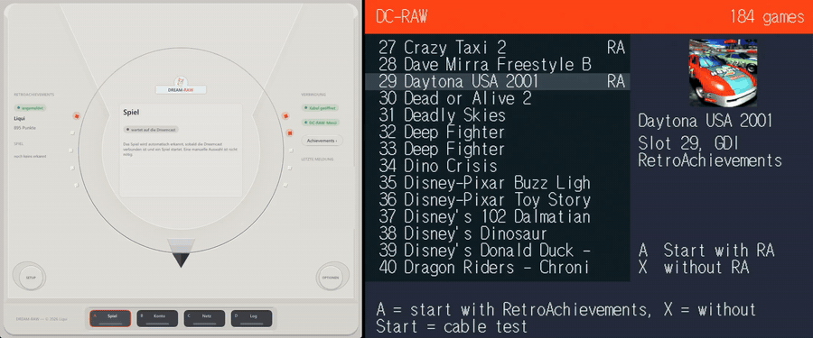

# DREAM-RAW

RetroAchievements auf einer echten Sega Dreamcast. Kein Emulator, keine
veränderten Disc-Abbilder.

[English](README.md) · [Projektseite](https://liquid-wq.github.io/dream-raw/)

DREAM-RAW verbindet eine echte Dreamcast mit einem GDEMU, einem seriellen
Kabel und RetroAchievements. Auf der Konsole ersetzt das DC-RAW-Menü dein
GDEMU-Menü und startet deine Spiele. Während ein Spiel läuft, schickt es die
Werte, die ein Achievement-Set braucht, über das Kabel an den PC. Das Programm
auf dem PC prüft die Achievements und schaltet sie auf deinem
RetroAchievements-Konto frei. Deine Spiel-Abbilder bleiben unverändert.

Wird ein Achievement freigeschaltet, erscheint eine Karte am Bildschirmrand.

## Was du brauchst

- Eine Sega Dreamcast mit GDEMU
- Ein serielles Kabel für den seriellen Anschluss der Dreamcast, oft Coder's
  Cable genannt, mit einem USB-Seriell-Adapter für 3,3 V. Am besten eignet
  sich ein CP2102N-Chip mit RTS/CTS. Es gibt solche Kabel fertig zu kaufen,
  oder du baust eins selbst – wie, steht in [docs/WIRING.md](docs/WIRING.md)
  (englisch).
- Windows
- Ein kostenloses RetroAchievements-Konto
- Deine Spiele als GDI-Abbilder auf der SD-Karte des GDEMU

## Loslegen

1. Das neueste Release herunterladen und `DREAM-RAW.exe` starten. Beim ersten
   Start wählst du die Sprache und meldest dich mit deinem
   RetroAchievements-Konto an.
2. Die Dreamcast ausschalten und die SD-Karte des GDEMU in den PC stecken.
   Unter **SETUP** auf **Auf SD-Karte einrichten** klicken. Das Programm
   findet die Karte selbst, prüft über das Internet, welche deiner Spiele ein
   Achievement-Set haben, und schreibt das DC-RAW-Menü samt allem Nötigen auf
   Platz 01. Das Kabel braucht es dafür nicht.
3. Auf **Karte auswerfen** klicken und die Karte zurück in den GDEMU stecken.
   Das Kabel an Dreamcast und PC anschließen, DREAM-RAW laufen lassen und die
   Dreamcast einschalten.
4. Im DC-RAW-Menü ein Spiel wählen und A drücken. DREAM-RAW erkennt das Spiel
   selbst.

Was vorher auf Platz 01 lag, wird in einen Sicherungsordner auf der Karte
verschoben, und **OPTIONEN → Ursprüngliches Menü wiederherstellen** holt es
zurück. Bei Spielen mit vielen Spuren benennt das Einrichten die Spurdateien
so um, dass der GDEMU sie laden kann; das Wiederherstellen des ursprünglichen
Menüs setzt auch diese Namen zurück.

## Gut zu wissen

Hardcore gibt es noch nicht. Jede Freischaltung zählt als Softcore.

Spiele ohne Achievement-Set starten ganz normal aus dem DC-RAW-Menü.
CDI-Abbilder, meist Homebrew, lassen sich daraus noch nicht starten.

## Fehler und Rückmeldungen

Fehler bitte über [GitHub Issues](https://github.com/liquid-wq/dream-raw/issues)
melden, mit dem Spiel, deiner Hardware und dem Protokoll aus dem
Programmfenster (**Kopieren** auf der Protokollseite). Nur dort verfolge ich
sie.

## Lizenz

DREAM-RAW ist kostenlos nutzbar. Der Quelltext des PC-Programms ist zum Lesen
und Prüfen öffentlich, aber nicht Open Source – siehe [LICENSE](LICENSE). Das
DC-RAW-Menü für die Konsole ist im Programm enthalten. Komponenten von
Drittanbietern stehen in [THIRD-PARTY-NOTICES.txt](THIRD-PARTY-NOTICES.txt).

Es gibt auch Fassungen für andere Konsolen: [MEGA-RAW](https://github.com/liquid-wq/mega-raw)
für das Mega Drive, [RAW-NES](https://github.com/liquid-wq/raw-nes) für das NES,
[RAW-SNES](https://github.com/liquid-wq/raw-snes) für das SNES und
[RAW-TURN](https://github.com/liquid-wq/raw-turn) für den Saturn.

Gebaut von Liqui.
