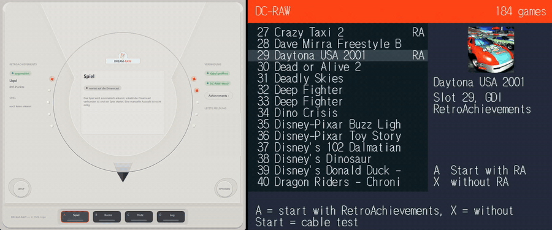

# DREAM-RAW

RetroAchievements on a real Sega Dreamcast. No emulator, no patched disc images.

[Deutsche Fassung](README.de.md) · [Project page](https://liquid-wq.github.io/dream-raw/)

DREAM-RAW connects a real Dreamcast with a GDEMU, a serial cable and
RetroAchievements. On the console, the DC-RAW menu takes the place of your
GDEMU menu and starts your games. While a game runs, it passes the values an
achievement set needs to the PC over the cable. The program on the PC checks
the achievements and unlocks them on your RetroAchievements account. Your game
images stay untouched.

When an achievement unlocks, a card appears at the edge of your screen.

## What you need

- A Sega Dreamcast with a GDEMU
- A serial cable for the Dreamcast's serial port, often called a Coder's Cable,
  with a 3.3 V USB-to-serial adapter. A CP2102N chip with RTS/CTS works best.
  You can buy one ready-made or build it yourself:
  [docs/WIRING.md](docs/WIRING.md) shows how.
- Windows
- A free RetroAchievements account
- Your games as GDI images on the GDEMU's SD card

## Getting started

1. Download the latest release and start `DREAM-RAW.exe`. The first start asks
   for your language and lets you log in with your RetroAchievements account.
2. Switch the Dreamcast off and put the GDEMU's SD card into your PC. Under
   **SETUP** click **Set up on SD card**. The program finds the card by
   itself, checks over the internet which of your games have an achievement
   set, and writes the DC-RAW menu together with what it needs onto slot 01.
   The cable is not needed for this.
3. Click **Eject card** and put the card back into the GDEMU. Connect the
   cable to the Dreamcast and the PC, keep DREAM-RAW running and switch the
   Dreamcast on.
4. In the DC-RAW menu, pick a game and press A. DREAM-RAW detects the game
   by itself.

Whatever was on slot 01 before is moved into a backup folder on the card, and
**OPTIONS → Restore original menu** puts it back. Games whose disc has many
tracks get their track files renamed during setup so the GDEMU can load them;
restoring the original menu sets those names back too.

## Good to know

Hardcore is not available yet. Every unlock is recorded as Softcore.

Games without an achievement set start normally from the DC-RAW menu. CDI
images, mostly homebrew, can't be started from it yet.

## Bugs and feedback

Please report bugs through [GitHub Issues](https://github.com/liquid-wq/dream-raw/issues),
with the game, your hardware and the log from the program window
(**Copy** on the log page). That is the only place I track them.

## License

DREAM-RAW is free to use. The source of the PC program is public to read and
audit, but it is not open source — see [LICENSE](LICENSE). The DC-RAW menu
for the console ships inside the program. Third-party components are listed
in [THIRD-PARTY-NOTICES.txt](THIRD-PARTY-NOTICES.txt).

There are versions for other consoles too: [MEGA-RAW](https://github.com/liquid-wq/mega-raw)
for the Mega Drive, [RAW-NES](https://github.com/liquid-wq/raw-nes) for the NES,
[RAW-SNES](https://github.com/liquid-wq/raw-snes) for the SNES and
[RAW-TURN](https://github.com/liquid-wq/raw-turn) for the Saturn.

Built by Liqui.
