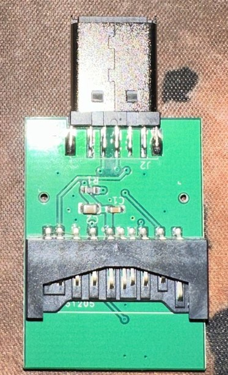
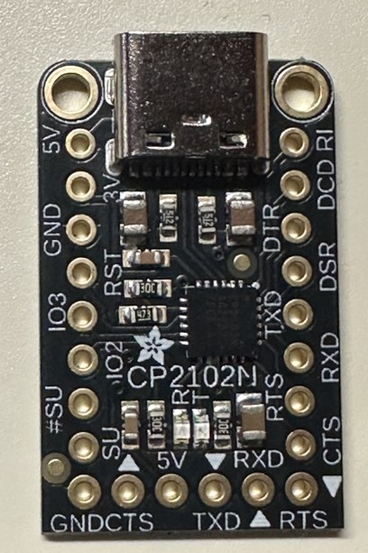
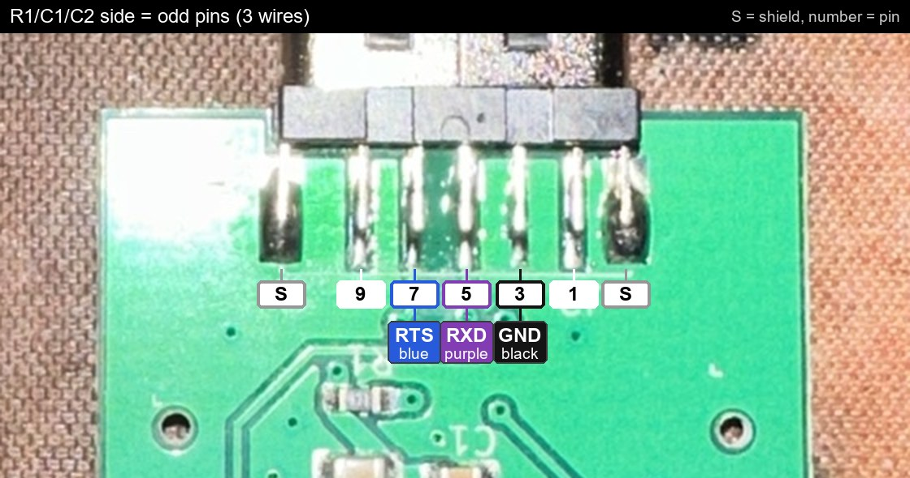
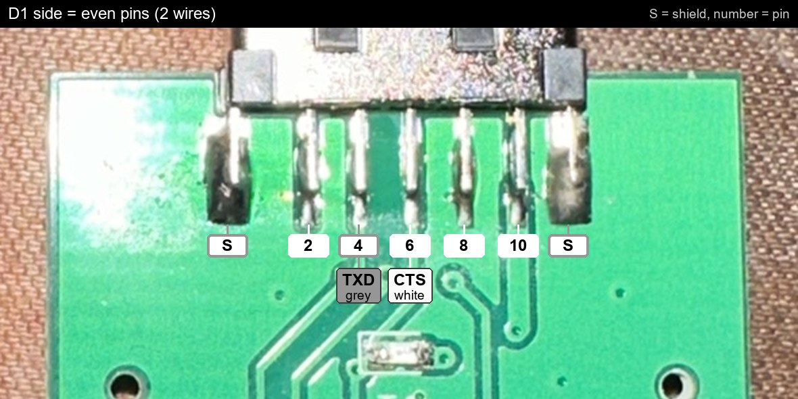
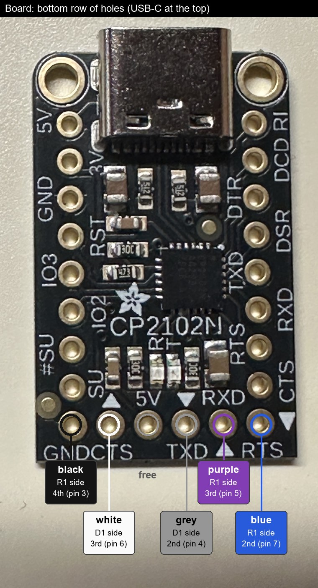

# Building the serial cable

DREAM-RAW talks to the Dreamcast through a cable on the console's serial port,
often called a Coder's Cable. If you already have one with a 3.3 V USB-to-serial
adapter and the RTS and CTS lines, you can skip this page.

Otherwise you need two parts and five wires: a plug for the serial port and a
small USB-to-serial board. This page shows how I built mine. The parts are an
example, not a requirement.

## The parts I used

| | |
|:---:|:---:|
|  |  |
| **The plug:** an SD card adapter for the Dreamcast's serial port (the board says "DC_SD_Adapter"). Its card slot comes off before soldering. | **The USB board:** Adafruit CP2102N Friend. |

Any plug that fits the serial port works. For the USB board I recommend one
with a **CP2102N** chip; other boards work as long as they run at **3.3 V**
and bring out **RTS and CTS**. Never use a 5 V adapter: the Dreamcast's serial
port works with 3.3 V.

You also need thin stranded wire in five colours, a soldering iron with a fine
tip, thin solder, flux, a multimeter, Kapton or insulating tape and hot glue.

## The plug

Hold the plug with the contacts pointing up and look straight at one side.
Each side has seven legs: a wide shield leg on the outside of each end and five
signal legs in between. On the adapter I used, the side with the parts R1, C1
and C2 carries the odd pins, the side with D1 the even pins. Check this on
yours with a multimeter: pin 3 is ground.

Five wires are needed, three on the odd side and two on the even side:

- Pin 3, ground → **GND** on the board (black)
- Pin 5, where the Dreamcast sends → **RXD** on the board (purple)
- Pin 7 → **RTS** on the board (blue)
- Pin 4, where the Dreamcast receives → **TXD** on the board (grey)
- Pin 6 → **CTS** on the board (white)

Send and receive cross over, and so do RTS and CTS. Leave every other leg free,
above all pin 1 (+5 V) and pin 10 (+3.3 V).

## The USB board

On the Adafruit board the five wires go to the bottom row (USB-C at the top):
GND, CTS, TXD, RXD and RTS. The 5V hole in that row stays free, and so do the
5V and 3V holes elsewhere. The board is powered over USB. On another board,
use the holes with the same names.

## Checking it

Before the first use, with the Dreamcast switched off:

1. Check continuity of each of the five wires, from leg to hole.
2. Check that there is no continuity between neighbouring legs.
3. Plug the board into the PC alone. A CP2102N board shows up in the Device
   Manager as a "Silicon Labs CP210x" COM port.

Then plug the cable into the Dreamcast, start DREAM-RAW and switch the console
on. As soon as the program says that the Dreamcast is in the DC-RAW menu, the
line from the console to the PC works. Pressing Start in the DC-RAW menu runs a
cable test; the full result appears in the log of the program.
